<h1 align="center">
  <picture>
    <source media="(prefers-reduced-motion: reduce)" srcset=".github/assets/hero.png">
    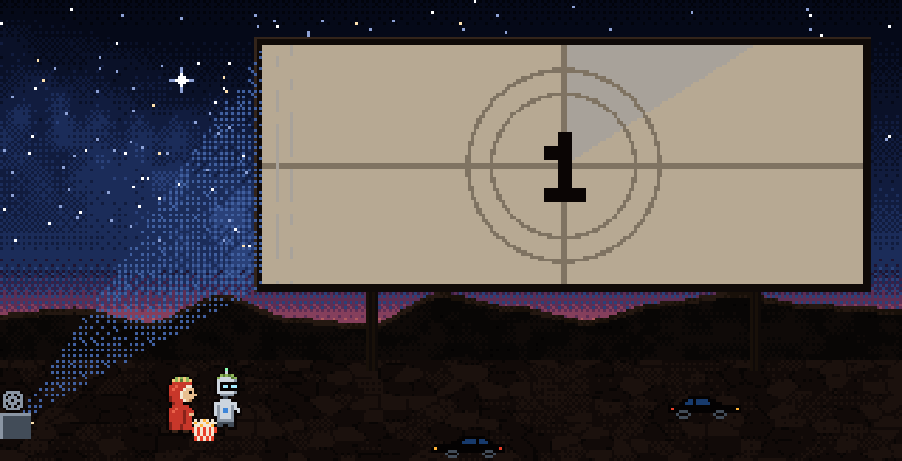
  </picture>
</h1>

<p align="center">
  <b>Pide una película con tus palabras. Dante lee todas las versiones, elige una y te dice por qué.</b><br>
  Un conserje de cine con IA para <a href="https://claude.com/claude-code">Claude Code</a>.
</p>

<p align="center">
  <a href="https://github.com/4TheDoctor/dante/releases/latest"></a>
  <a href="https://github.com/4TheDoctor/dante/actions/workflows/ci.yml"></a>
  
  
  <a href="LICENSE"></a>
</p>

<p align="center">
  <a href="#empezar">Empezar</a> ·
  <a href="#cinco-letras-cinco-pasos">Cómo funciona</a> ·
  <a href="#los-nueve-círculos">Los nueve círculos</a> ·
  <a href="#funciona-con">Funciona con</a> ·
  <a href="#privacidad-y-límites">Privacidad</a> ·
  <a href="README.md">English</a>
</p>

<p align="center"></p>

<p align="center">
  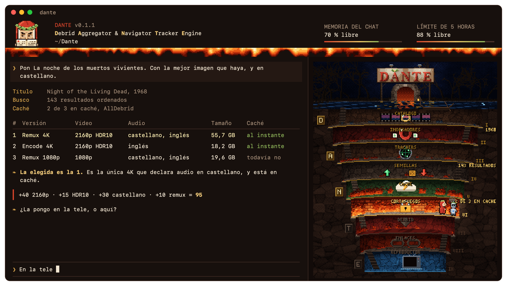
  <br><sub>Una ilustración: la respuesta y sus números son inventados, los dibujos son los de Dante. La película es de dominio público.</sub>
</p>

## Por qué

Las herramientas para buscar y resolver enlaces ya son maduras. Lo que faltaba es alguien que lea todos los
resultados, sepa que quieres 4K Dolby Vision con audio en castellano, note que el mejor vídeo no tiene
castellano pero otra versión sí, y te diga cuál elegir y por qué.

Eso es Dante.

## Qué te da

<table>
  <tr>
    <td width="50%" valign="top">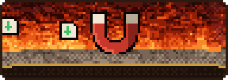<h3>Una pregunta, todos tus motores</h3>Tu AIOStreams, tus addons de Stremio y tu Jackett o Prowlarr, consultados a la vez. Dante no rastrea nada por su cuenta.</td>
    <td width="50%" valign="top">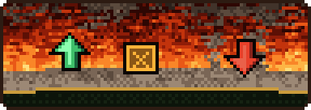<h3>Razones, no solo una elección</h3>Cada versión recibe puntos, y cada punto viene con palabras: <code>+25 DV</code>, <code>-10 no Castilian Spanish audio known</code>. Puedes comprobar la elección.</td>
  </tr>
  <tr>
    <td valign="top">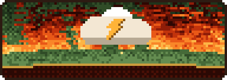<h3>Lo instantáneo, señalado</h3>Pregunta a AllDebrid, Real-Debrid y TorBox qué tienen ya, y limpia lo que tuvo que añadir para averiguarlo.</td>
    <td valign="top">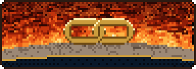<h3>El idioma que falta</h3>¿La mejor imagen no trae tu idioma y otra versión sí? Dante prepara el doblaje con <a href="https://github.com/4TheDoctor/audio4films">audio4films</a>: sincronizado, sin pérdida y verificado.</td>
  </tr>
  <tr>
    <td valign="top">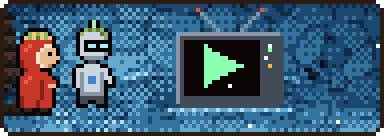<h3>Lo pone donde estés</h3>IINA, VLC o mpv en el ordenador, o una fuente «Dante» dentro de Stremio en cualquier aparato de casa. También la tele.</td>
    <td valign="top">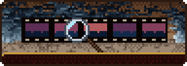<h3>Discos Blu-ray enteros</h3>Discos BDMV completos con sus menús: los menús se copian y la película se queda en el montaje de red.</td>
  </tr>
</table>

## Empezar

Hace falta [Claude Code](https://claude.com/claude-code) y Node 22 o posterior.

```bash
npm install -g https://github.com/4TheDoctor/dante/releases/latest/download/dante.tgz
dante
```

La primera vez, Dante te pide tus motores y las claves del debrid, crea `~/Dante` y ofrece instalar
[audio4films](https://github.com/4TheDoctor/audio4films), que solo hace falta para los doblajes. Después, háblale:

> *Pon La noche de los muertos vivientes, con la mejor imagen que haya, en castellano.*
>
> *¿Qué versión de esa ocupa menos de 20 GB y sigue siendo HDR?*
>
> *Pon el siguiente episodio en la tele.*

| Orden | Qué hace |
| --- | --- |
| `dante` | Abre Claude Code en `~/Dante`, con las herramientas y el aspecto de Dante |
| `dante doctor` | Revisa Claude Code, motores, cuentas de debrid, reproductores y audio4films |
| `dante search TÍTULO --season 3 --episode 6` | La misma clasificación, sin la IA |
| `dante setup` | Cambia motores, claves o preferencias |

## Cinco letras, cinco pasos

<table>
  <tr>
    <td align="center" width="20%"></td>
    <td align="center" width="20%">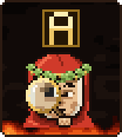</td>
    <td align="center" width="20%">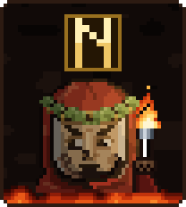</td>
    <td align="center" width="20%">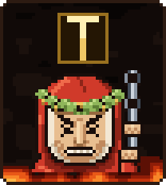</td>
    <td align="center" width="20%"></td>
  </tr>
  <tr>
    <td align="center" valign="top"><b>Título</b><br>Averigua qué película o episodio dices</td>
    <td align="center" valign="top"><b>Búsqueda</b><br>Pregunta a todos los motores y clasifica lo que llega</td>
    <td align="center" valign="top"><b>Caché</b><br>Mira cuáles tiene listas tu debrid</td>
    <td align="center" valign="top"><b>Añadir</b><br>Añade la que elijas, y ninguna más</td>
    <td align="center" valign="top"><b>Reproducir</b><br>La abre en el ordenador o en la tele</td>
  </tr>
</table>

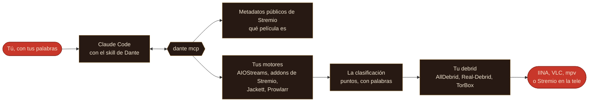

**Las razones vienen con palabras.** Esto es salida real de `dante search` con una película de dominio público
y los nombres de las versiones abreviados:

```text
Night of the Living Dead (1968): 143 results after ranking, from torrentio (145).

1. torrentio:1  score 95  … 4Kremux2160 ….mkv
   2160p · HDR10 · REMUX · DD · 2.0 · 55.7 GB · 0 seeders · …
   audio: Castilian Spanish, English · cache unknown
   why: +40 2160p (preference 1 of 2) | +15 HDR10 | +30 audio in Castilian Spanish | +10 remux (untouched video and audio)
```

Dante distingue un idioma que la versión *declara como audio* de uno que solo *menciona*, que puede ser nada más
que subtítulos. Lo que no se sabe, se dice que no se sabe.

## Los nueve círculos

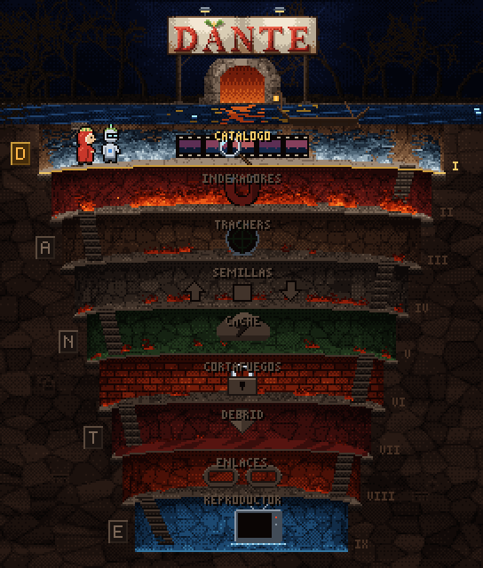

Al lado del chat, Dante y su guía robot bajan los nueve círculos de la descarga. Cada paso hacia abajo responde a
algo que de verdad ha ocurrido en tu petición.

| | Trabajando | Hecho |
| --- | --- | --- |
| **D** | I · Catálogo | II · Indexadores |
| **A** | III · Trackers | IV · Semillas |
| **N** | V · Caché | VI · Cortafuegos |
| **T** | VII · Debrid | VIII · Enlaces |
| **E** | IX · Reproductor | Bajo las estrellas |

- Lo que encontró cada paso queda tallado en la roca, junto a su letra.
- La nube se enciende cuando una versión está en caché, y el río se llena con la descarga.
- Si algo falla, su círculo se rompe bajo una luz roja y el cartel dice por qué.
- Al final, el logo de la película aparece en pixel art en la pantalla del autocine.

<br clear="right">

A resolución completa en **Ghostty** y **kitty**, con caracteres de bloque en cualquier otra terminal. Se abre
solo a partir de 144 columnas. Claude Code no se modifica: son sus hooks oficiales, y los dibujos se hacen en tu
ordenador.

<details>
<summary><b>Órdenes para curiosear</b></summary>
<br>

| Orden | Qué hace |
| --- | --- |
| `/inferno` | Oculta o muestra los círculos |
| `/inferno demo` | Los recorre todos con datos inventados; no busca ni añade nada |
| `/inferno 1` a `9` | Va a un círculo |
| `/inferno error 1` a `9` | Rompe uno, para verlo |
| `/inferno stars TÍTULO` | El final, con el logo de esa película |
| `/inferno stop` | Termina el ensayo |

En `dante.toml`: `animation = "full" | "calm" | "off"` y `graphics = "auto" | "image" | "blocks"`.

</details>

## Funciona con

| Qué | Cuáles |
| --- | --- |
| **Motores** | AIOStreams, cualquier addon de Stremio (Comet, Torrentio, MediaFusion…), Jackett, Prowlarr |
| **Debrid** | AllDebrid, Real-Debrid, TorBox |
| **Reproductores** | IINA, VLC, mpv, Stremio en cualquier aparato de tu red |
| **Terminales** | Ghostty y kitty a resolución completa; cualquier otra con caracteres de bloque |
| **Sistemas** | macOS y Linux |
| **Interfaz** | Inglés, español |

<details>
<summary><b>¿Qué motor me conviene?</b></summary>
<br>

| Motor | Qué da | Qué necesita |
| --- | --- | --- |
| AIOStreams | Muchos addons y debrids en una sola búsqueda, con la caché por resultado | Tu instancia (un `docker run`) o una pública. Una pública ve tus claves de debrid |
| Addon de Stremio | Lo que encuentre ese addon; marcas de caché si tiene tu clave | Su URL de manifiesto (se guarda en el Llavero) |
| Jackett / Prowlarr | Tus indexadores, y discos Blu-ray completos | URL Torznab y clave |

</details>

## Hazlo tuyo

Dos archivos en `~/Dante`. Uno para las reglas:

```toml
# dante.toml
ui_language = "es"

[preferences]
resolutions  = ["2160p", "1080p"]          # de mejor a peor
hdr          = ["DV", "HDR10+", "HDR10"]   # de mejor a peor
languages    = ["spa"]                     # el audio que quieres, de mejor a peor
dub_fallback = true                        # ¿la mejor imagen no trae castellano? ofrecer un doblaje
avoid        = ["CAM", "3D"]
```

Y otro para el gusto, `CLAUDE.md`, con tus palabras: *«ciencia ficción densa, acción con oficio, nunca un cam»*.

Si usas [VoiceMode](https://github.com/mbailey/voicemode), `voice = "NOMBRE"` en `dante.toml` le da a Dante una voz propia.

## Privacidad y límites

- **Tus claves se quedan contigo:** en el Llavero de macOS, o en Linux en el Secret Service o en variables de entorno.
- **Sin servidor y sin telemetría.** Dante habla con tus motores, tu debrid y los metadatos públicos de Stremio para títulos y logos. Lo que escribes va a Claude, como en cualquier sesión de Claude Code.
- **Mirar la caché** en AllDebrid y Real-Debrid significa añadir el torrent, mirar y quitarlo, salvo que ya lo tuvieras: no ofrecen una consulta de solo lectura. TorBox sí.
- **En la tele,** la fuente «Dante» se sirve desde tu ordenador mientras haya una sesión de Dante abierta.
- **Solo vídeo:** películas, series, documentales y anime. No busca software, juegos, plugins ni librerías de sonido, ni páginas de torrents en internet, ni vigila inscripciones de trackers privados.
- **Los menús BD-J** pueden ir lentos en VLC: es un límite de libbluray.

Dante no aloja nada, no indexa nada y no recomienda ninguna fuente. Lee el [aviso](DISCLAIMER.md).

## Constrúyelo

TypeScript, un solo paquete npm: una CLI pequeña (`dante`), un servidor MCP que arranca Claude Code (`dante mcp`),
un plugin de Claude Code (`plugin/`: el skill, la conexión MCP y el Inferno), y los motores, la clasificación y el debrid en `src/`.

```bash
npm install && npm test
node dist/cli.js doctor
claude --plugin-dir plugin          # el plugin en una sesión normal de Claude Code
node scripts/draw-readme.mjs        # vuelve a dibujar las imágenes de esta página
```

Se agradecen incidencias y cambios. Una buena primera: un motor o un debrid que uses y Dante no conozca.

## Gracias a

- [AIOStreams](https://github.com/Viren070/AIOStreams), [Comet](https://github.com/g0ldyy/comet), [MediaFusion](https://github.com/mhdzumair/MediaFusion) y [Torrentio](https://github.com/TheBeastLT/torrentio-scraper): los motores con los que habla Dante.
- [StremThru](https://github.com/MunifTanjim/stremthru), [Debrid Media Manager](https://github.com/debridmediamanager/debrid-media-manager) y [zurg](https://github.com/debridmediamanager/zurg-public): capas y bibliotecas de debrid.
- [stremio-mcp](https://github.com/YoanWai/stremio-mcp): un servidor MCP para Stremio y Android TV; va bien con Dante para la tele.

<p align="center"></p>

<p align="center">
  <i>E quindi uscimmo a riveder le stelle.</i><br>
  <sub>Inferno XXXIV, 139. El de este Dante acaba en un autocine. · <a href="LICENSE">MIT</a></sub>
</p>
