<h1 align="center">
  <picture>
    <source media="(prefers-reduced-motion: reduce)" srcset=".github/assets/hero.png">
    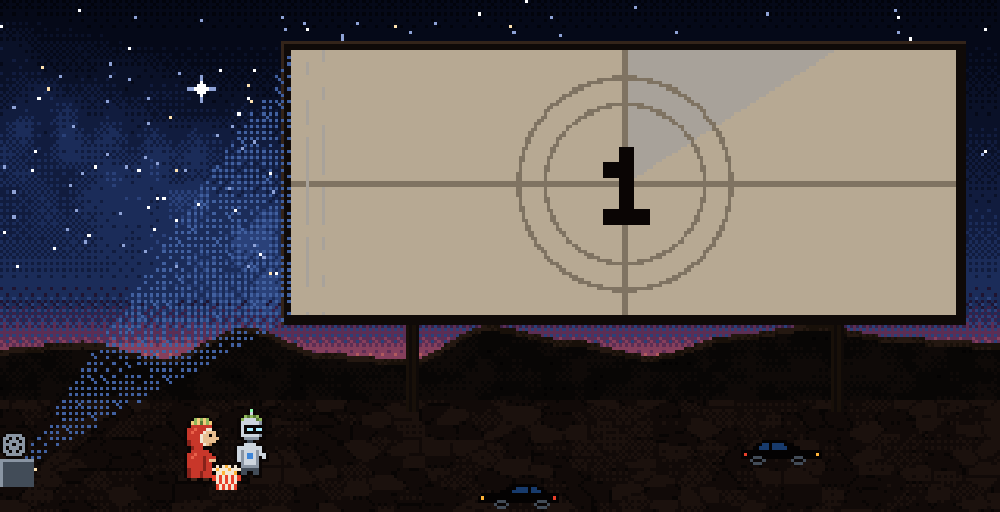
  </picture>
</h1>

<p align="center">
  <b>Ask for a film in plain words. Dante reads every release, picks one, and tells you why.</b><br>
  An AI media concierge for <a href="https://claude.com/claude-code">Claude Code</a>.
</p>

<p align="center">
  <a href="https://github.com/4TheDoctor/dante/releases/latest"></a>
  <a href="https://github.com/4TheDoctor/dante/actions/workflows/ci.yml"></a>
  
  
  <a href="LICENSE"></a>
</p>

<p align="center">
  <a href="#quick-start">Quick start</a> ·
  <a href="#five-letters-five-steps">How it works</a> ·
  <a href="#the-nine-circles">The nine circles</a> ·
  <a href="#works-with">Works with</a> ·
  <a href="#privacy-and-limits">Privacy</a> ·
  <a href="README.es.md">Español</a>
</p>

<p align="center"></p>

<p align="center">
  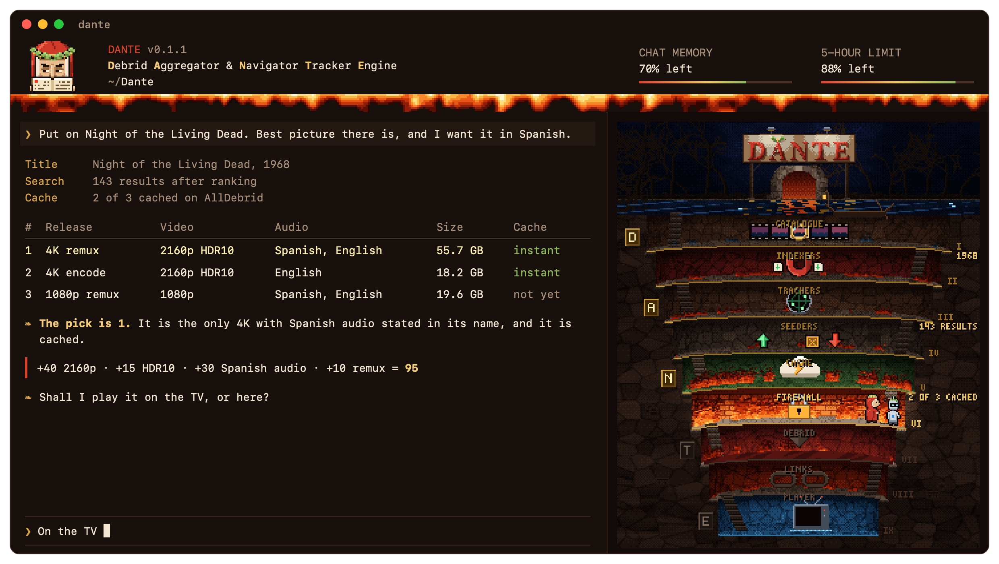
  <br><sub>An illustration: the reply and its numbers are made up, the drawings are Dante's own. The film is in the public domain.</sub>
</p>

## Why

The tools that search and resolve streams are mature. What was missing is someone who reads all the results,
knows you want 4K Dolby Vision with Castilian audio, notices that the best picture has no Spanish track but
another release does, and tells you which one and why.

That is Dante.

## What you get

<table>
  <tr>
    <td width="50%" valign="top">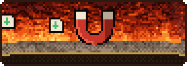<h3>One question, every engine</h3>Your AIOStreams, your Stremio addons and your Jackett or Prowlarr, searched at the same time. Dante scrapes nothing itself.</td>
    <td width="50%" valign="top"><h3>Reasons, not just a pick</h3>Every release gets points, and every point comes in words: <code>+25 DV</code>, <code>-10 no Castilian Spanish audio known</code>. You can check the choice.</td>
  </tr>
  <tr>
    <td valign="top">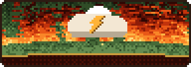<h3>What is instant, marked</h3>It asks AllDebrid, Real-Debrid and TorBox what they already have, and cleans up whatever it had to add to find out.</td>
    <td valign="top">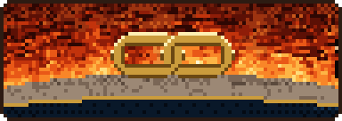<h3>The language gap, filled</h3>The best picture lacks your language and another release has it? Dante plans the dub for <a href="https://github.com/4TheDoctor/audio4films">audio4films</a>: in sync, lossless, verified.</td>
  </tr>
  <tr>
    <td valign="top">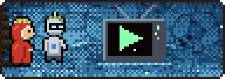<h3>It plays where you are</h3>IINA, VLC or mpv on the computer, or a "Dante" source inside Stremio on any device at home. The TV too.</td>
    <td valign="top">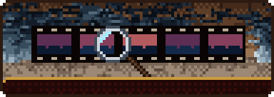<h3>Whole Blu-ray discs</h3>Full BDMV discs with their menus: the menu files are copied, the film stays on the network mount.</td>
  </tr>
</table>

## Quick start

You need [Claude Code](https://claude.com/claude-code) and Node 22 or newer.

```bash
npm install -g https://github.com/4TheDoctor/dante/releases/latest/download/dante.tgz
dante
```

The first time, Dante asks for your engines and debrid keys, creates `~/Dante`, and offers to install
[audio4films](https://github.com/4TheDoctor/audio4films), which only dubs need. After that, talk to it:

> *Put on Night of the Living Dead, the best picture there is, in Spanish.*
>
> *Which version of that is under 20 GB and still HDR?*
>
> *Play the next episode on the TV.*

| Command | What it does |
| --- | --- |
| `dante` | Opens Claude Code in `~/Dante`, with Dante's tools and look |
| `dante doctor` | Checks Claude Code, engines, debrid accounts, players and audio4films |
| `dante search TITLE --season 3 --episode 6` | The same ranking without the AI |
| `dante setup` | Changes engines, keys or preferences |

## Five letters, five steps

<table>
  <tr>
    <td align="center" width="20%"></td>
    <td align="center" width="20%"></td>
    <td align="center" width="20%">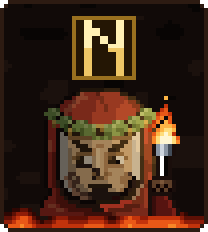</td>
    <td align="center" width="20%">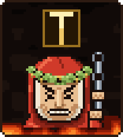</td>
    <td align="center" width="20%"></td>
  </tr>
  <tr>
    <td align="center" valign="top"><b>Title</b><br>Finds which film or episode you mean</td>
    <td align="center" valign="top"><b>Search</b><br>Asks every engine and ranks what comes back</td>
    <td align="center" valign="top"><b>Cache</b><br>Sees which ones your debrid has ready</td>
    <td align="center" valign="top"><b>Add</b><br>Adds the one you choose, and no other</td>
    <td align="center" valign="top"><b>Play</b><br>Opens it on the computer or the TV</td>
  </tr>
</table>

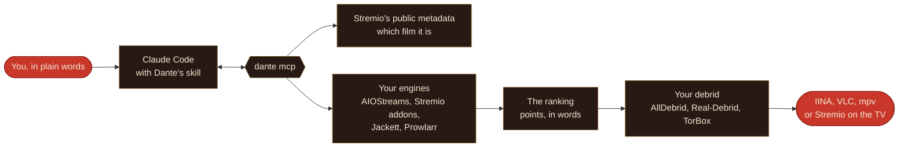

**The reasons come in words.** This is real output of `dante search` on a public-domain film, with the release
names shortened:

```text
Night of the Living Dead (1968): 143 results after ranking, from torrentio (145).

1. torrentio:1  score 95  … 4Kremux2160 ….mkv
   2160p · HDR10 · REMUX · DD · 2.0 · 55.7 GB · 0 seeders · …
   audio: Castilian Spanish, English · cache unknown
   why: +40 2160p (preference 1 of 2) | +15 HDR10 | +30 audio in Castilian Spanish | +10 remux (untouched video and audio)
```

Dante tells apart a language the release *states as audio* from one it only *mentions*, which may be just
subtitles. What is not known is said to be not known.

## The nine circles

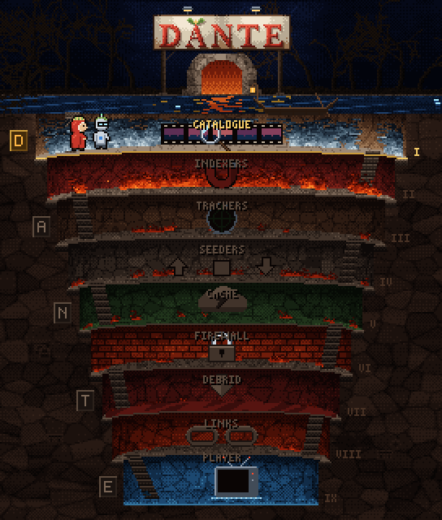

Beside the chat, Dante and his robot guide go down the nine circles of the download. Every step down stands for
something that really happened in your request.

| | Working | Done |
| --- | --- | --- |
| **D** | I · Catalogue | II · Indexers |
| **A** | III · Trackers | IV · Seeders |
| **N** | V · Cache | VI · Firewall |
| **T** | VII · Debrid | VIII · Links |
| **E** | IX · Player | Under the stars |

- What each step found is cut in the rock beside its letter.
- The cloud lights up when a release is cached, and the river fills with the download.
- When something fails, its circle breaks under a red light and the sign says why.
- At the end, the film's own logo is redrawn in pixel art on the screen of the drive-in.

<br clear="right">

Full resolution in **Ghostty** and **kitty**, block characters in any other terminal. It opens by itself from
144 columns. Claude Code itself is not modified: these are its official hooks, and the drawings are made on your
computer.

<details>
<summary><b>Commands to look around</b></summary>
<br>

| Command | What it does |
| --- | --- |
| `/inferno` | Hides or shows the circles |
| `/inferno demo` | Walks through all of them with made-up data; searches and adds nothing |
| `/inferno 1` to `9` | Goes to one circle |
| `/inferno error 1` to `9` | Breaks one, to see it |
| `/inferno stars TITLE` | The end, with that film's logo |
| `/inferno stop` | Ends the rehearsal |

In `dante.toml`: `animation = "full" | "calm" | "off"` and `graphics = "auto" | "image" | "blocks"`.

</details>

## Works with

| What | Which |
| --- | --- |
| **Engines** | AIOStreams, any Stremio addon (Comet, Torrentio, MediaFusion…), Jackett, Prowlarr |
| **Debrid** | AllDebrid, Real-Debrid, TorBox |
| **Players** | IINA, VLC, mpv, Stremio on any device in your network |
| **Terminals** | Ghostty and kitty in full resolution; any other with block characters |
| **Systems** | macOS and Linux |
| **Interface** | English, Spanish |

<details>
<summary><b>Which engine should I use?</b></summary>
<br>

| Engine | Gives | Needs |
| --- | --- | --- |
| AIOStreams | Many addons and debrids in one search, cached or not per result | Your own instance (one `docker run`) or a public one. A public instance sees your debrid keys |
| Stremio addon | Whatever that addon finds; cache markers if it has your debrid key | Its manifest URL (kept in the Keychain) |
| Jackett / Prowlarr | Your indexers, and full Blu-ray discs | Torznab URL and API key |

</details>

## Make it yours

Two files in `~/Dante`. One for rules:

```toml
# dante.toml
[preferences]
resolutions  = ["2160p", "1080p"]          # best first
hdr          = ["DV", "HDR10+", "HDR10"]   # best first
languages    = ["spa"]                     # the audio you want, best first
dub_fallback = true                        # no Castilian in the best picture? offer a dub
avoid        = ["CAM", "3D"]
```

And one for taste, `CLAUDE.md`, in your own words: *"dense science fiction, action made with craft, never a cam"*.

If you use [VoiceMode](https://github.com/mbailey/voicemode), `voice = "NAME"` in `dante.toml` gives Dante a voice of its own.

## Privacy and limits

- **Your keys stay with you:** in the macOS Keychain, or on Linux in the Secret Service or environment variables.
- **No server and no telemetry.** Dante talks to your engines, your debrid, and Stremio's public metadata for titles and logos. What you type goes to Claude, as in any Claude Code session.
- **Checking the cache** on AllDebrid and Real-Debrid means adding the torrent, looking and removing it again, unless you already had it: they have no read-only check. TorBox does.
- **On the TV,** the "Dante" source is served from your computer while a Dante session is open.
- **Only video:** films, series, documentaries and anime. Not software, games, plugins or sample packs, and it does not look for torrent sites on the web or watch private-tracker sign-ups.
- **BD-J menus** can be slow in VLC, which is a libbluray limit.

Dante hosts nothing, indexes nothing and recommends no source. Read the [disclaimer](DISCLAIMER.md).

## Build it

TypeScript, one npm package: a small CLI (`dante`), an MCP server that Claude Code starts (`dante mcp`), a Claude
Code plugin (`plugin/`: the skill, the MCP wiring and the Inferno), and the engines, ranking and debrid code in `src/`.

```bash
npm install && npm test
node dist/cli.js doctor
claude --plugin-dir plugin          # the plugin in a plain Claude Code session
node scripts/draw-readme.mjs        # redraw the pictures of this page
```

Issues and pull requests are welcome. A good first one: an engine or a debrid service you use and Dante does not know.

## Thanks to

- [AIOStreams](https://github.com/Viren070/AIOStreams), [Comet](https://github.com/g0ldyy/comet), [MediaFusion](https://github.com/mhdzumair/MediaFusion) and [Torrentio](https://github.com/TheBeastLT/torrentio-scraper): the engines Dante talks to.
- [StremThru](https://github.com/MunifTanjim/stremthru), [Debrid Media Manager](https://github.com/debridmediamanager/debrid-media-manager) and [zurg](https://github.com/debridmediamanager/zurg-public): debrid layers and libraries.
- [stremio-mcp](https://github.com/YoanWai/stremio-mcp): an MCP server for Stremio and Android TV; pairs well with Dante for the TV.

<p align="center"></p>

<p align="center">
  <i>E quindi uscimmo a riveder le stelle.</i><br>
  <sub>Inferno XXXIV, 139. Dante's own ends at a drive-in. · <a href="LICENSE">MIT</a></sub>
</p>
